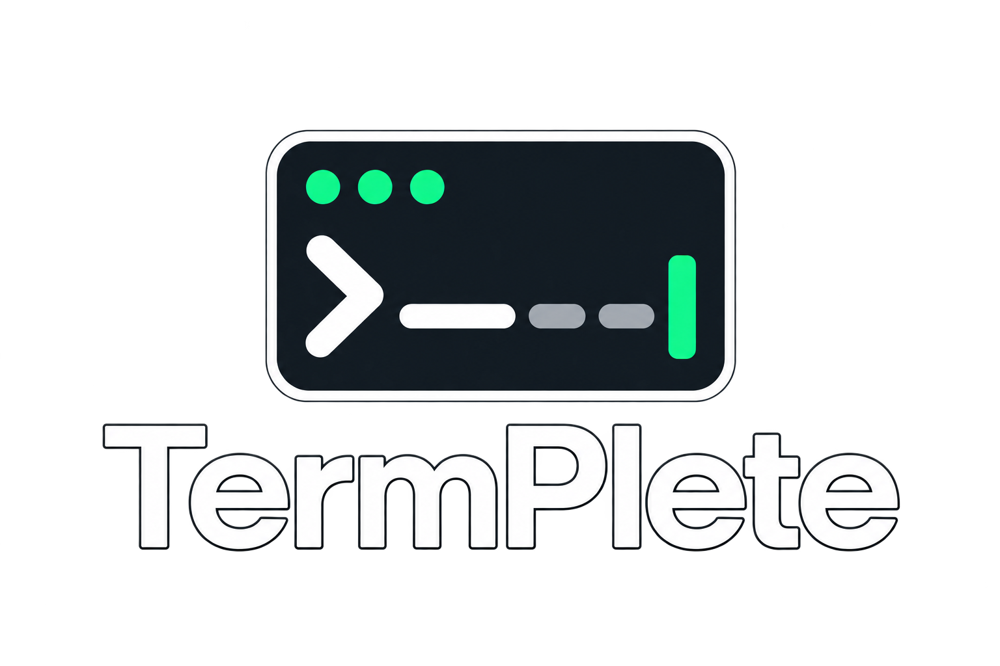
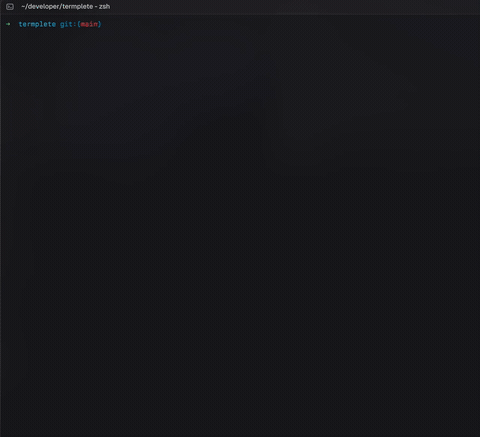

<p align="center">
  
</p>

<h1 align="center">TermPlete</h1>

<p align="center">
  <strong>Autocomplete that learns your workflow.</strong><br>
  Your command history, terminal context and AI — in the shell you already use.
</p>

<p align="center">
  <a href="LICENSE"></a>
  <a href="CONTRIBUTING.md"></a>
  <a href="#supported-environments"></a>
</p>

<p align="center">
  <a href="#quick-start">Quick start</a> ·
  <a href="#features">Features</a> ·
  <a href="#everyday-use">Keyboard guide</a> ·
  <a href="docs/USAGE.md">Full guide</a> ·
  <a href="CONTRIBUTING.md">Contribute</a>
</p>

TermPlete suggests commands from your own history, learns which options you
accept, and uses a configured model when more context is needed. Browse
alternatives, insert the one you want, then run it yourself.

**Automatic** shows suggestions as you type. **On demand** waits for Ctrl+G or
Tab. Accepting a suggestion never executes it.

## See it in action

<p align="center">
  <a href="assets/termplete-preview.mp4">
    
  </a>
</p>

<p align="center">
  <a href="assets/termplete-preview.mp4"><strong>▶ Watch the 45-second demo</strong></a><br>
  Status, settings and command completion in a real zsh session.
</p>

## Quick start

**From a published release**, install both executables and run setup:

```sh
curl -fsSL https://github.com/aft1n/termplete/releases/latest/download/install.sh | sh
export PATH="$HOME/.local/bin:$PATH"
tp setup
```

The installer downloads the matching macOS or Linux archive, verifies its
SHA-256 checksum and installs in `~/.local/bin`. It does not require Rust or
edit your shell configuration. You can [read the installer](scripts/install.sh)
in this repository, or download and inspect the exact release copy first:

```sh
curl -fsSL https://github.com/aft1n/termplete/releases/latest/download/install.sh -o install.sh
less install.sh
sh install.sh
```

**With npm**, after the package is published, install the command and run setup:

```sh
npm install -g termplete
tp setup
```

**With Homebrew**, after the release workflow publishes the formula:

```sh
brew tap aft1n/termplete https://github.com/aft1n/termplete
brew install aft1n/termplete/termplete
tp setup
```

**From a checkout of this repository**, build and install with Rust:

```sh
cargo install --locked --path .
tp setup
```

Setup connects your provider, asks for an available model and a masked API key,
and adds the shell integration. Local Ollama and LM Studio presets need no key.
Ensure Cargo's binary directory is on `PATH`, then open a new terminal.

```sh
tp settings    # mode, provider, shortcuts, appearance and preferences
tp status      # active model, key source, daemon and diagnostics
```

Try typing `git l`, press Tab to browse options, and press Enter or Right Arrow to insert
one. Press Enter when you are ready to run it.

> [!NOTE]
> Release installation becomes available after a version tag passes CI and its
> release workflow completes. That workflow publishes the verified curl
> installer and updates the Homebrew formula. Use the explicit tap URL above
> because the source repository is named `termplete`; Homebrew's one-argument
> shorthand expects a repository named `homebrew-termplete` instead.
> npm publication is a separate maintainer step. See the
> [release runbook](docs/RELEASING.md) for the current status and install steps.

<details>
<summary><strong>Build in place or install the shell integration manually</strong></summary>

```sh
cargo build --locked --release
export PATH="$PWD/target/release:$PATH"
```

Keep `termplete` and `tp` together: the full-name executable runs the app and
`tp` is its short launcher. macOS Keychain access requests use `termplete`.

For zsh, add this once to `~/.zshrc`:

```sh
eval "$(tp init --print zsh)"
```

For Bash, add this once to `~/.bashrc`:

```sh
eval "$(tp init --print bash)"
```

Open a new shell after setup. Automatic zsh output capture runs internally;
there is no need to start a separate TermPlete session. See the
[installation guide](docs/USAGE.md#install-and-start) for more detail.
Use `tp stop` to pause already-loaded integrations and `tp start` to resume
them; shells opened while stopped need a new shell after resuming.

</details>

## Features

| Feature | What it does for you |
| --- | --- |
| **Instant history** | Reuses known commands, arguments and SSH targets through local prefix and lexical search |
| **Adaptive learning** | Shares freshness, bounded frequency and decaying acceptance ranking across commands and directories; fresh clear choices become consistent local answers |
| **Context-aware AI** | Uses bounded recent commands, output, exit status and visible directory facts to infer the next useful command |
| **Human task descriptions** | Turns `# describe what you need` into command options after Enter |
| **Real directory completion** | Resolves `cd` against actual folders instead of inventing paths or splicing stale suffixes |
| **Optional decision models** | Ranks known choices and checks generation with a local or remote helper, independently of the command LLM |
| **Terminal-friendly UI** | Offers readable shortcuts, high-contrast selection, short fades and pending shimmer, plus static/no-color fallbacks |
| **Provider flexibility** | Supports hosted presets, local models and custom OpenAI-compatible base URLs |
| **Privacy controls** | Scrubs recognized secrets, excludes private paths, stores keys in the OS credential store and offers local-only requests |
| **Enable controls** | Pause TermPlete globally or disable it only in apps such as Warp |

Model calls run asynchronously. Browsing one returned batch does not make extra
AI requests. Backspace dismisses suggestions immediately; an empty line shows
no TermPlete UI, and stale replies cannot restore dismissed content.

[Explore all workflows →](docs/USAGE.md) · [Contributing and validation →](CONTRIBUTING.md)

## Everyday use

### Type → browse → insert → run

| Action | Default key |
| --- | --- |
| Reveal or retry a suggestion | **Ctrl+G** |
| Open selector / next option | **Tab** |
| Previous option | **Shift+Tab** |
| Navigate shell history | **Up / Down** |
| Insert the selected command | **Enter** in the selector or **Right Arrow** |
| Insert the next suggested word (zsh) | **Option/Alt+Right Arrow** |
| Close the selector | **Esc** |
| Dismiss / interrupt | **Ctrl+C** |
| Toggle TermPlete | **Ctrl+X Ctrl+X** |

Up / Down always keep normal shell history and multiline navigation, including
while suggestions are visible. While enabled,
TermPlete owns Tab for suggestions. Enter in the selector and Right Arrow insert
the highlighted command. **A separate Enter executes** it after the selector closes.
Option/Alt+Right inserts one word and leaves the rest as ghost text, so you can accept
a useful prefix and replace the remaining arguments. Word boundaries follow
zsh's normal forward-word behavior. Without a visible suggestion, Option/Alt+Right
keeps its existing cursor movement.
Custom shortcuts are captured with readable names in Settings, and can be reset
with **Reset shortcuts to defaults → Save and exit**.

### Describe what you need

In zsh, type a task and press Enter:

```text
# change dog.mp4 into dog.mov with ffmpeg
```

A possible suggestion is:

```sh
ffmpeg -i dog.mp4 dog.mov
```

Browse options, press Enter or Right Arrow to replace the description, review the command,
then press Enter to run it. The model does not execute anything. A bare `#`
sends no request; editing the description cancels pending generation.

[Task-generation guide →](docs/USAGE.md#generate-a-command-from-a-task)

### Choose how suggestions appear

| Visibility mode | Behavior |
| --- | --- |
| **Automatic** — default | Shows suggestions as you type |
| **On demand** | Waits for Ctrl+G or Tab |

**History matches** is a separate preference. **Instant** returns ranked local
matches without a model; **AI chooses** asks AI to select a known match. Repeated
trusted choices can still answer immediately. An active decision helper can rank
history even when Instant is selected.

[Modes and history explained →](docs/USAGE.md#choose-modes-and-history-behavior)

## Connect your models

Open `tp setup`, or **Settings → AI provider**. Choose a provider and an exact
model ID available to your account or installed locally.

- **Hosted presets:** OpenAI, Anthropic, OpenRouter, Groq, Together, DeepSeek,
  Mistral, Gemini, xAI and Fireworks.
- **ChatGPT subscription:** authenticated through OpenAI Codex; no API
  key is stored by termplete.
- **Local generation:** Ollama and LM Studio, without an API key.
- **Custom endpoint:** enter a unique name, base URL, model and API key in
  **Provider → Custom OpenAI-compatible provider**.

Suggestions automatically disable reasoning where supported, or request the
lowest supported effort for models that require it. No setting is needed.
Custom endpoints and older local servers without reasoning controls retain
their native behavior.

Custom-provider keys remain masked drafts until you choose **Save and exit**.
Stored keys can be replaced or removed; existing-provider keychain actions take
immediate effect and invalidate the daemon's cached credential. An environment
fallback remains usable after a stored entry is removed.

```sh
tp auth providers
tp auth status
tp auth login --provider openai --force   # masked replacement prompt
tp auth remove --provider openai
```

For a ChatGPT subscription, select `openai-acp` in `tp setup`, or run:

```sh
tp auth login --provider openai-acp --use-provider
```

On first sign-in, Termplete installs the Codex CLI into its
user cache with npm; a global install is not required. Node.js/npm and internet
access are needed for that first install. An existing `codex` on `PATH` is reused.
Termplete opens Codex's browser sign-in flow; Codex manages the credentials.
Termplete sends each completion through Codex app-server in a fresh ephemeral,
read-only thread from a temporary directory. It confirms that the thread is
ephemeral before sending terminal context, so suggestions are not saved as
Codex chats. Inherited apps, plugins, MCP servers, lifecycle hooks and
notification commands are disabled; terminal context is withheld if the helper
cannot confirm isolation.
The desktop app can be closed; the helper connects to OpenAI
independently. The provider ID `openai-acp` is retained for existing configs.
In **Settings → AI provider**, choose **ChatGPT subscription**, then select
**Sign in to ChatGPT**.

[Provider setup and key management →](docs/USAGE.md#connect-a-provider)

### Optional decision helper

The decision model and command generator have separate settings. Choose the
strategy under **AI provider → Decision helper**:

| Strategy | Who does the work? |
| --- | --- |
| **Standard AI** — default | Local completion and the ordinary command LLM; helper inactive |
| **Decision only** | Helper ranks known local commands; no new-command generation |
| **Decision + AI** | Helper selects known commands or permits the command LLM to generate new ones |

Ollama Tev and TypeSafe Jev use native SystemOne. OpenAI-compatible and Anthropic
chat models use the validated Chat JSON contract. The helper ranks supplied IDs
and privacy flags; it does not supply arbitrary executable commands.

With **Decision + AI** and default **Block** privacy, a timed-out, busy or invalid
helper can fall back to the LLM using only safe active text. That fallback drops
all history, output, directory metadata and learned preferences. Explicit privacy
denials, Decision only and failed required local review remain local.

```sh
# With Ollama running and tev1:0.8b already installed:
tp config set --key decision.provider --value ollama
tp config set --key decision.model --value tev1:0.8b
tp config set --key decision.strategy --value hybrid
tp config set --key decision.enabled --value true
tp decision check --timeout-ms 10000 --json
```

The check uses synthetic context. A cold model can exceed the default 1,500 ms
interactive budget; connectivity success does not guarantee useful decisions.
Turn the helper off without losing its saved settings:

```sh
tp config set --key decision.enabled --value false
```

[Decision pipeline, protocols and privacy rules →](docs/decision-models.md)

## Make it yours

Settings uses short menus with Up/Down or j/k, Enter to select and Esc/q to go
back. **Save and exit** applies configuration; leaving the main menu otherwise
discards edits. Existing-provider keychain changes are immediate.

| Settings area | Controls |
| --- | --- |
| **Mode** | Automatic or On demand |
| **AI provider** | Generator, model, keys, custom endpoints and decision helper |
| **Keyboard shortcuts** | Capture bindings and restore defaults |
| **Appearance** | Ghost/accent colors and animation |
| **Preferences** | Global enable, suggestion history scope, output capture and terminal exclusions |

Selected options use bold black text on cyan; other rows use the terminal's
normal foreground. Pending text shimmers without moving your command or cursor.
`NO_COLOR`, `TERM=dumb`, `TERMPLETE_NO_ANIM=1` and disabled animations keep it static.

To keep Warp's own suggestions:

```sh
tp config set --key disabled_terminals --value warp
```

Pause TermPlete without uninstalling it in **Settings → Preferences → TermPlete enabled**.
Save and exit to apply; return there and choose **On** when you want it back. The
same switch is available in the CLI with `tp config set --key enabled --value false`.

Restart an existing shell after changing exclusions. The default exclusion list
is empty. Output-capture changes also apply to new terminal sessions.

[Settings guide →](docs/USAGE.md#settings-and-terminal-appearance) ·
[Configuration reference →](docs/CONFIGURATION.md)

## Privacy and context

TermPlete can include your typed text, bounded recent commands/output, exit
statuses, current directory and immediate visible file/folder names in model
requests. It does not open file contents or recursively scan directories.

- **Keys** live in the OS credential store, with optional provider environment
  fallbacks; they are not written into TermPlete config or command memory.
- **Known secrets and credential paths** are scrubbed or excluded before models
  see them. Configured private paths remain hard-blocked.
- **Block** is the default soft-metadata policy. Local review allows only an
  active loopback judge to inspect hard-filtered soft private metadata; remote
  generators still receive fully filtered context.
- **Data stays bounded** in `~/.termplete`: configuration, recent context,
  command memory, accepted-choice statistics and operational logs.

Redaction is best effort. Use local models or `--local-only` when you do not want
model requests to leave your machine. Disabling capture stops new output
collection; it does not erase previously saved data or disable directory facts.

```sh
tp suggest --local-only --json -- 'git l'
tp config set --key capture_output --value false
```

[Stored data, controls and deletion →](docs/USAGE.md#privacy-and-stored-data) ·
[Security policy →](SECURITY.md)

## Troubleshooting

Start with local completion, then inspect the AI path:

```sh
tp status
tp suggest --local-only --explain -- 'git l'
tp suggest --explain -- 'docker '
tp suggest --intent --json -- 'change dog.mp4 into dog.mov with ffmpeg'
```

| If you see… | Check… |
| --- | --- |
| No suggestions | Integration loaded once, TermPlete enabled, terminal not excluded, nonempty input |
| Local works, AI fails | Provider, exact model ID, credential source and `--explain` diagnostic |
| Keychain access stalls | Unlock the store and complete the OS access prompt |
| Helper timeout | Synthetic decision check; Hybrid + Block has a safe prompt-only fallback |
| `#` task has no new command | Strategy must permit generation; inspect privacy denials and generator errors |
| A shortcut inserts escape text | Recapture the terminal's actual shortcut or reset defaults |

`tp status` reports the log and configuration paths. Sanitize diagnostics before
sharing them. [Full troubleshooting guide →](docs/USAGE.md#troubleshooting)

## Supported environments

| Environment | Experience |
| --- | --- |
| **zsh 5.9+ on macOS / Linux** | Full inline suggestions, selector, automatic output capture and `#` tasks |
| **Bash on macOS / Linux** | Native readline completion and explicit preview; not the full zsh UI |
| **Other shells** | One-off CLI suggestions |
| **Native Windows** | Not currently supported by the Unix-socket integration or release packages |

Source builds need **Rust 1.89+**. Prepared native archives target macOS Apple
silicon/Intel and Linux ARM64/x86-64 with glibc 2.35+. The npm wrapper needs
Node.js 20+ once published. See [release availability](docs/RELEASING.md).

## Documentation and contributing

| Guide | Start here for… |
| --- | --- |
| [Usage](docs/USAGE.md) | Installation, daily workflows, learning, troubleshooting and uninstalling |
| [Configuration](docs/CONFIGURATION.md) | TOML settings, environment overrides and architecture |
| [Decision models](docs/decision-models.md) | Helper contracts, transports, privacy rules and fallback behavior |
| [Contributing](CONTRIBUTING.md) | Isolated development, source map and regression checks |
| [Releasing](docs/RELEASING.md) | Checksums, curl installer, Homebrew formula and npm publishing |
| [Security](SECURITY.md) | Vulnerability reporting and data boundaries |

For development, use temporary homes and no-auth mock providers. The regression
suites cover Rust behavior, real zsh PTYs, helper/generator integration,
distribution fixtures and the npm launcher. See the contribution guide for
commands and requirements.

## License and assets

[MIT](LICENSE) · Copyright 2026 TermPlete contributors.

[Logo and demo assets](assets/README.md) include the revised sans-serif wordmark,
its generation prompt, the feature recording and preview image.
